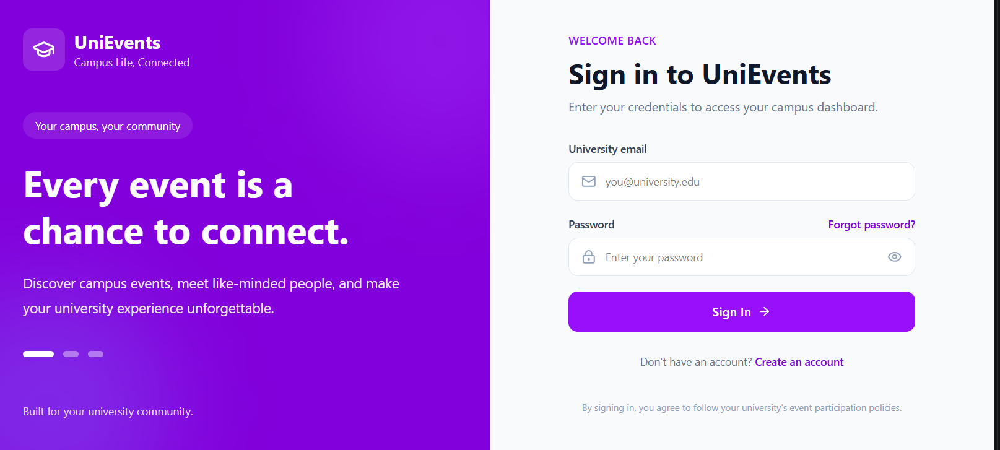
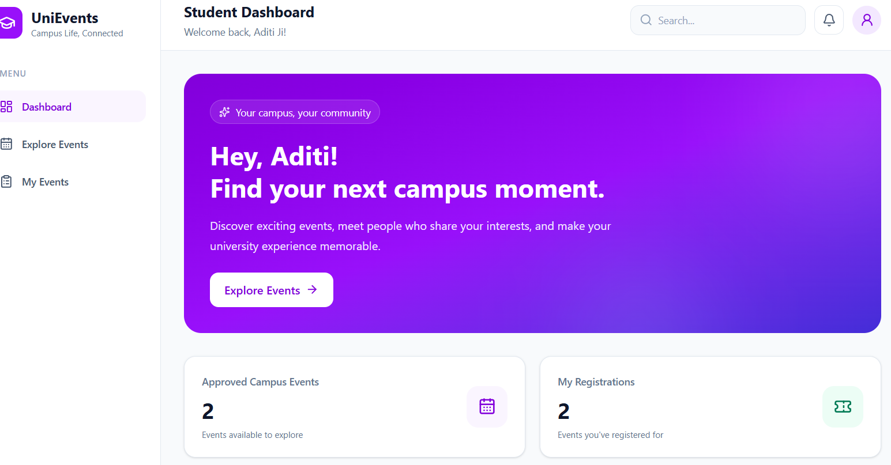
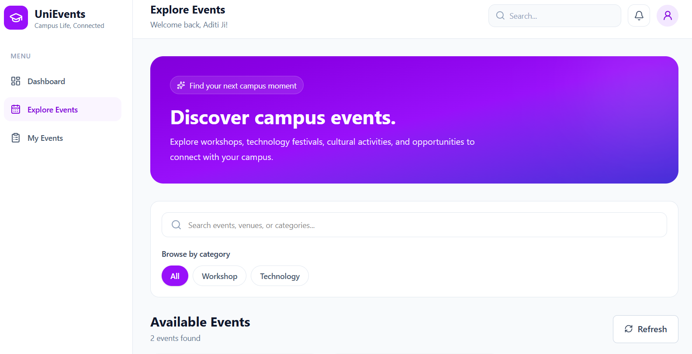
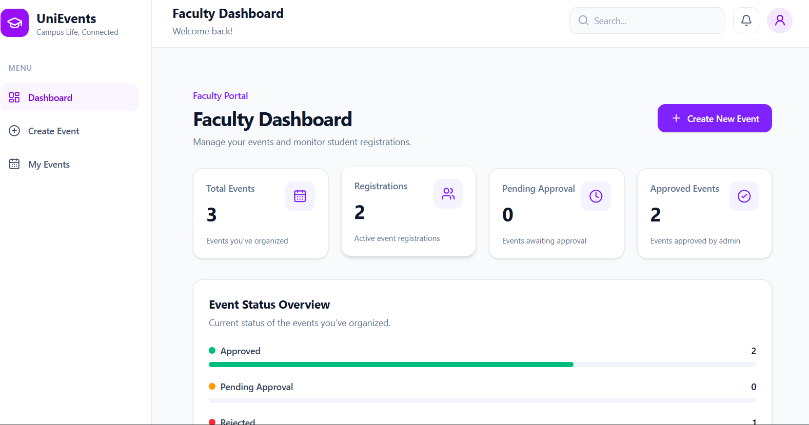
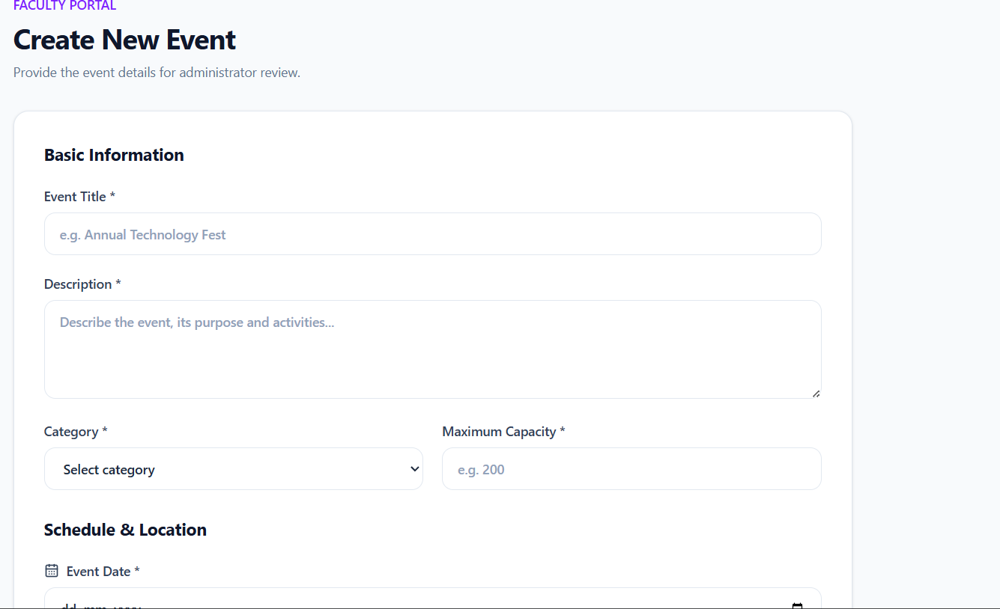
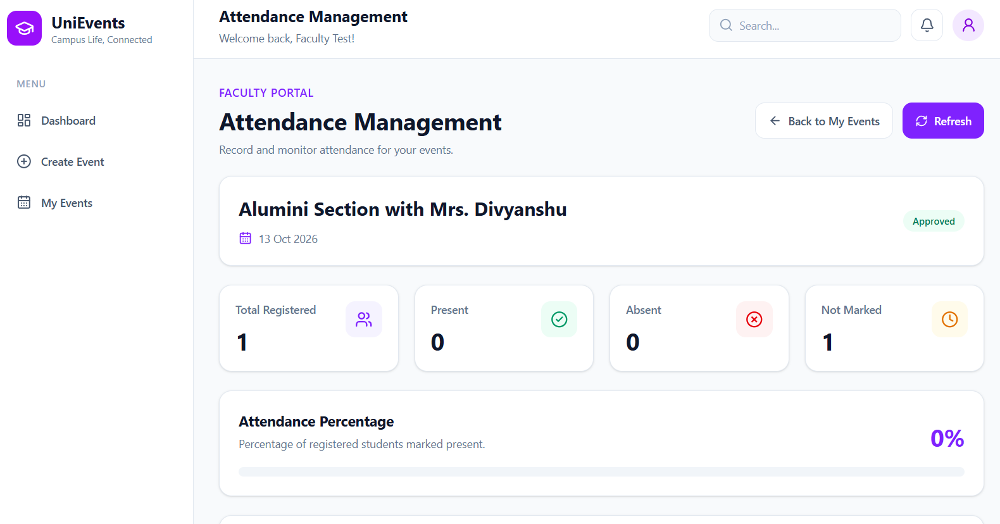
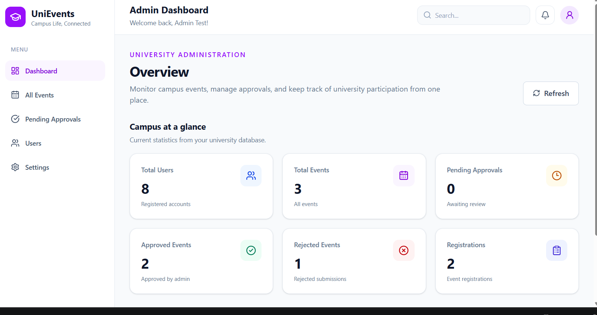
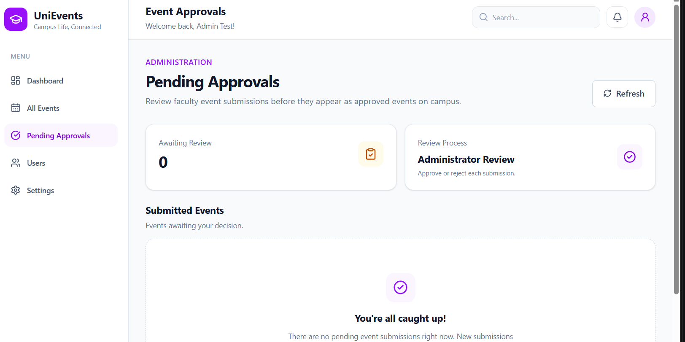

# UniEvents – University Event Management System

A full-stack web application designed to simplify university event management through role-based access for students, faculty, and administrators.

UniEvents provides a centralized platform where students can discover and register for events, faculty can organize events and manage attendance, and administrators can oversee event approvals and user management.

---

## 📸 Screenshots

### Authentication



### Student Module

| Student Dashboard                                       | Explore Events                                   |
| ------------------------------------------------------- | ------------------------------------------------ |
|  |  |

### Faculty Module

| Faculty Dashboard                                       | Create Event                                  |
| ------------------------------------------------------- | --------------------------------------------- |
|  |  |

### Attendance Management



### Admin Module

| Admin Dashboard                                     | Event Approval                                    |
| --------------------------------------------------- | ------------------------------------------------- |
|  |  |

---

## ✨ Key Features

### 👨‍🎓 Student

* Student registration and login.
* Explore available university events.
* Register for events.
* View registered events.
* Cancel event registrations.
* Forgot password and email-based password recovery.

### 👨‍🏫 Faculty

* Faculty dashboard.
* Create and manage events.
* Edit and delete events.
* View registered participants.
* Manage student attendance.
* Export attendance records as CSV.

### 🛡️ Administrator

* Admin dashboard with event statistics.
* Review pending event requests.
* Approve or reject events.
* Manage university events.
* View and manage registered users.

---

## 🛠️ Technology Stack

### Frontend

* React.js
* Vite
* Tailwind CSS
* Redux Toolkit
* React Router
* Axios
* Lucide React

### Backend

* Node.js
* Express.js
* MongoDB
* Mongoose
* JSON Web Token (JWT)
* bcrypt
* Nodemailer

### Development Tools

* Git and GitHub
* Visual Studio Code
* Postman
* MongoDB Compass

---

## 🏗️ Project Structure

```text
Event-Management-System/
│
├── backend/
│   ├── config/
│   ├── controllers/
│   ├── middleware/
│   ├── models/
│   ├── routes/
│   ├── services/
│   ├── utils/
│   ├── app.js
│   ├── server.js
│   ├── package.json
│   └── package-lock.json
│
├── frontend/
│   ├── public/
│   ├── src/
│   │   ├── components/
│   │   ├── pages/
│   │   ├── services/
│   │   ├── redux/
│   │   └── ...
│   ├── package.json
│   └── package-lock.json
│
├── screenshots/
│
├── .gitignore
└── README.md
```

---

## ⚙️ Installation and Setup

### Prerequisites

Make sure you have installed:

* Node.js
* npm
* MongoDB
* Git

### 1. Clone the Repository

```bash
git clone https://github.com/Divyanshu-T-1/UniEvents.git
```

```bash
cd UniEvents
```

### 2. Backend Setup

```bash
cd backend
npm install
```

Create a `.env` file inside the backend directory:

```env
PORT=5000
MONGO_URI=your_mongodb_connection_string
JWT_SECRET=your_jwt_secret
EMAIL_USER=your_email
EMAIL_APP_PASSWORD=your_email_app_password
FRONTEND_URL=http://localhost:5173
```

Add any other environment variables required by your backend configuration.

Start the backend:

```bash
npm run dev
```

### 3. Frontend Setup

Open another terminal:

```bash
cd frontend
npm install
```

Configure the frontend API base URL to point to your backend.

Start the frontend:

```bash
npm run dev
```

The application should now be accessible at:

**Frontend:** http://localhost:5173

**Backend:** http://localhost:5000

---

## 🔐 Security

* Passwords are hashed before storage.
* JWT-based authentication.
* Role-based authorization.
* Protected backend routes.
* Password reset using secure, time-limited tokens.
* Environment variables used for sensitive configuration.

---

## 🚀 Future Improvements

* Production deployment.
* Event notifications.
* Enhanced analytics and reporting.
* Improved mobile responsiveness.
* Additional event discovery and filtering options.

---

## 👨‍💻 Author

**Divyanshu Mishra**

B.Tech – Computer Science and Engineering (Artificial Intelligence)

Babu Banarasi Das University, Lucknow

[GitHub](https://github.com/Divyanshu-T-1)

---

⭐ If you find this project interesting, consider giving it a star!
